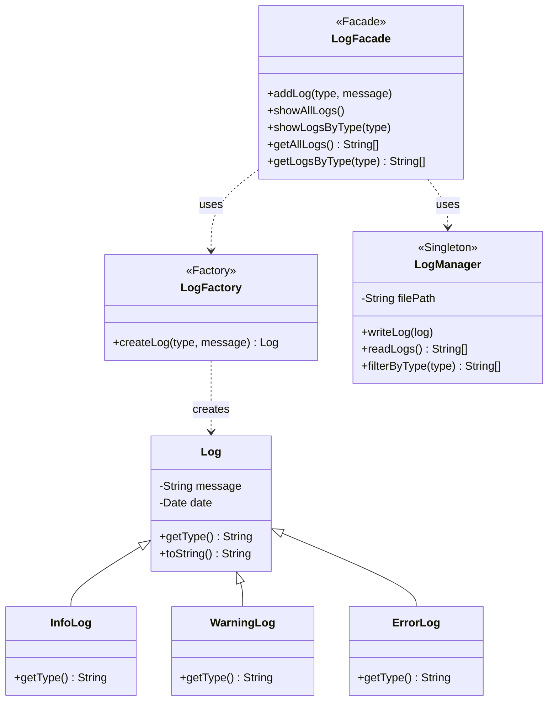

# Log-Management-System

A JavaScript (Node.js) application for managing log files. It demonstrates the **Factory**, **Singleton** and **Facade** design patterns, and can be used through a console menu or through a small HTTP API.

## Table of Contents

- [Project Overview](#project-overview)
- [Software Design Patterns](#software-design-patterns)
- [Project Structure](#project-structure)
- [Installation](#installation)
- [Usage](#usage)
  - [Console Menu](#console-menu)
  - [HTTP API](#http-api)
- [Log File Format](#log-file-format)
- [Concurrent Write Protection](#concurrent-write-protection)
- [UML Class Diagram](#uml-class-diagram)
- [Extending the System](#extending-the-system)
- [Technologies Used](#technologies-used)
- [Author](#author)

## Project Overview

The system supports multiple log types:

- `INFO`
- `WARNING`
- `ERROR`

Features:

- Creating log entries of different types
- Saving logs to a single, centralized file
- Reading logs from the file
- Filtering logs by type
- Write protection: only one write to the log file at a time (file locking)
- Console menu for user interaction
- HTTP API (`GET` and `POST`) with a simple test page

## Software Design Patterns

### Factory Pattern

Implemented by the `LogFactory` class (`patterns/factory/LogFactory.js`).

The client only provides the log type and the message. The factory decides which class to instantiate:

- `InfoLog`
- `WarningLog`
- `ErrorLog`

```javascript
const log = LogFactory.createLog("info", "User logged in");
```

Adding a new log type requires one new class and one new `case` in the factory.

### Singleton Pattern

Implemented by the `LogManager` class (`patterns/singleton/LogManager.js`).

It guarantees that only one instance manages access to the log file. The constructor returns the existing instance if one was already created, and the module exports that single instance, so every `require` returns the same object.

Benefits:

- Centralized file management
- Prevents multiple managers from being created
- A single place that controls writing to the file
- Easier maintenance

### Facade Pattern

Implemented by the `LogFacade` class (`patterns/facade/LogFacade.js`).

It provides a simplified interface to the entire logging system. Client code (the console menu and the HTTP server) works only with `LogFacade` and does not interact directly with `LogFactory` or `LogManager`.

```javascript
const logSystem = require("./patterns/facade/LogFacade");

logSystem.addLog("error", "Database connection failed");
logSystem.showAllLogs();
logSystem.showLogsByType("ERROR");

const all = logSystem.getAllLogs();          // returns an array
const errors = logSystem.getLogsByType("ERROR"); // returns an array
```

## Project Structure

```
Log-Management-System/
│
├── app.js                      # console menu
├── server.js                   # HTTP server (GET and POST requests)
├── test.html                   # test page for the POST request
│
├── storage/
│   └── logs.txt                # centralized log file (created automatically)
│
├── models/
│   ├── Log.js                  # base class
│   ├── InfoLog.js
│   ├── WarningLog.js
│   └── ErrorLog.js
│
└── patterns/
    ├── factory/
    │   └── LogFactory.js       # Factory Pattern
    ├── singleton/
    │   └── LogManager.js       # Singleton Pattern
    └── facade/
        └── LogFacade.js        # Facade Pattern
```

## Installation

Requirements:

- [Node.js](https://nodejs.org/) (no external packages are needed)

Verify the installation:

```bash
node -v
```

Clone the repository:

```bash
git clone https://github.com/<your-username>/Log-Management-System.git
cd Log-Management-System
```

The `storage` folder and `logs.txt` are created automatically on first use.

## Usage

### Console Menu

Run the application from the project folder:

```bash
node app.js
```

```
===== LOG MANAGEMENT =====
1. Add INFO log
2. Add WARNING log
3. Add ERROR log
4. Show all logs
5. Show INFO logs
6. Show WARNING logs
7. Show ERROR logs
0. Exit
```

At `Choice:` enter only the number of the option. For options 1-3 the program then asks for a `Message:`.

Example session:

```
Choice: 3
Message: Database connection failed
ERROR log added.

Choice: 7
[ERROR] 11/17/2026, 10:15:52 AM - Database connection failed
```

### HTTP API

Start the server:

```bash
node server.js
```

The server listens on `http://localhost:3000`.

| Method | Route                | Description                                                              |
|--------|----------------------|--------------------------------------------------------------------------|
| GET    | `/test`              | Opens the test page (`test.html`)                                        |
| GET    | `/logs`              | Returns all logs as JSON                                                 |
| GET    | `/logs?type=ERROR`   | Returns only logs of the given type (`INFO`, `WARNING` or `ERROR`)       |
| POST   | `/logs`              | Adds a new log. Body: `{ "type": "INFO", "message": "..." }`             |

Add a log (Linux/macOS shell):

```bash
curl -X POST http://localhost:3000/logs \
  -H "Content-Type: application/json" \
  -d '{"type":"INFO","message":"Testing POST request"}'
```

Response:

```json
{ "success": true, "message": "Log added successfully" }
```

Get logs:

```bash
curl http://localhost:3000/logs
curl "http://localhost:3000/logs?type=ERROR"
```

```json
{
  "success": true,
  "count": 1,
  "logs": ["[ERROR] 11/17/2026, 10:15:52 AM - Database connection failed"]
}
```

You can also open `http://localhost:3000/test` in a browser and send a POST request from the test page.

Validation and errors:

| Status | When                                                                         |
|--------|------------------------------------------------------------------------------|
| 201    | Log added successfully                                                       |
| 400    | Invalid JSON, missing or empty `message`, or invalid log type                |
| 404    | Unknown route, or `test.html` not found                                      |

The request body is limited to 10,000 characters.

## Log File Format

All logs are stored in `storage/logs.txt`, one entry per line:

```
[TYPE] date, time - message
```

```
[INFO] 11/17/2026, 10:15:30 AM - User logged in
[WARNING] 11/17/2026, 10:15:41 AM - Low memory warning
[ERROR] 11/17/2026, 10:15:52 AM - Database connection failed
```

The date format depends on the system locale (`toLocaleString()`). Filtering by type matches the `[TYPE]` prefix at the start of each line.

## Concurrent Write Protection

Writing to the log file is protected so that two writes never happen at the same time:

1. Before each write, `LogManager` creates a lock file (`storage/logs.lock`) using the `wx` flag, which succeeds for only one process at a time.
2. Other writers wait briefly and retry (up to 100 attempts).
3. After the write, the lock is always removed (`try/finally`).
4. A stale lock (older than 5 seconds, for example after a crash) is removed automatically.

Because the write uses `fs.appendFileSync` and `LogManager` is a Singleton, writes inside one process are also sequential. The lock file additionally protects against two copies of the program writing to the same file.

## UML Class Diagram



Relationships:

- `InfoLog`, `WarningLog` and `ErrorLog` inherit from `Log`
- `LogFactory` creates `Log` objects
- `LogFacade` uses `LogFactory` and `LogManager`
- `LogManager` has a single shared instance (Singleton)

## Extending the System

To add a new log type, for example `DEBUG`:

1. Create `models/DebugLog.js`:

   ```javascript
   const Log = require("./Log");

   class DebugLog extends Log {
       getType() {
           return "DEBUG";
       }
   }

   module.exports = DebugLog;
   ```

2. In `LogFactory.js` add `const DebugLog = require("../../models/DebugLog");` and a new case:

   ```javascript
   case "debug":
       return new DebugLog(message);
   ```

3. Optionally add menu options in `app.js` and add `DEBUG` to the list of allowed types in `server.js`.

`LogManager` and `LogFacade` do not need to change.

## Technologies Used

- JavaScript
- Node.js
- File System (`fs`) and `path` modules
- `http` module (HTTP server)
- Object-Oriented Programming (OOP)

## Author

Course Project - Software Design Patterns

Implemented patterns:

- Factory Pattern
- Singleton Pattern
- Facade Pattern
